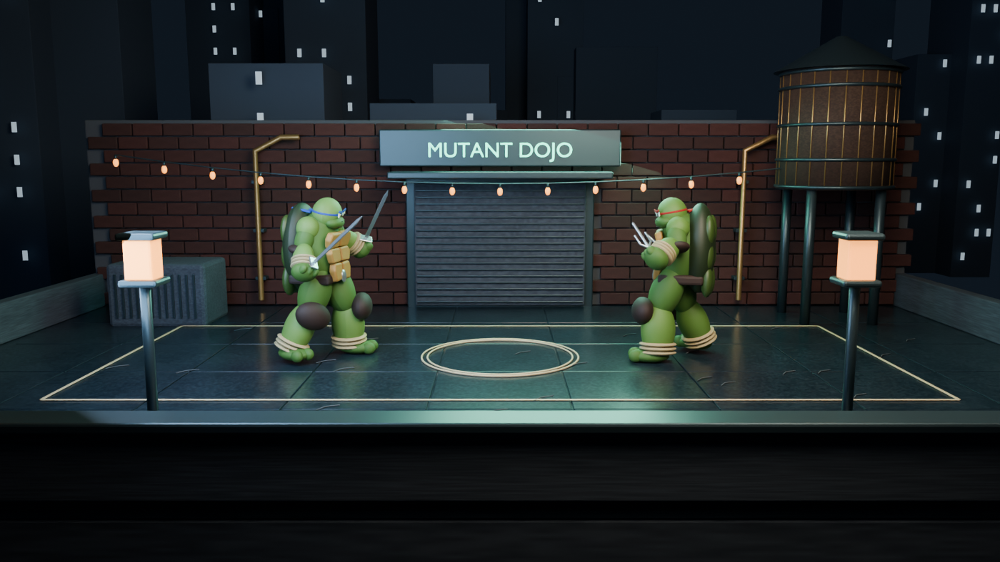
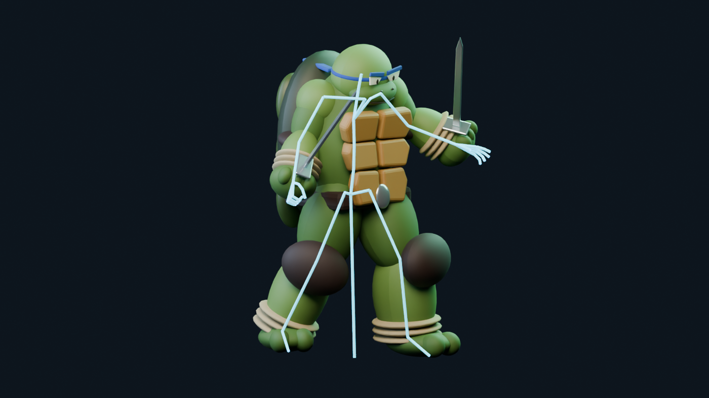
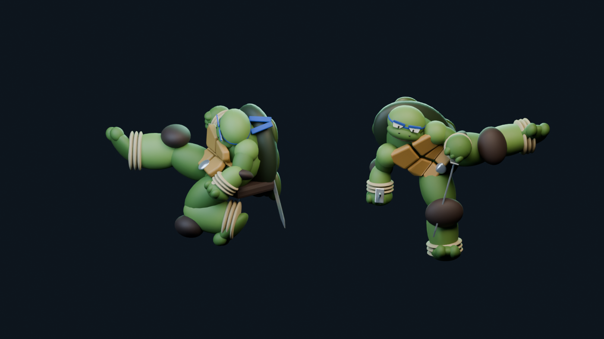

# Mutant Dojo

A TMNT-inspired 3D fighting game built with **Three.js and Blender**, with a dedicated rig and motion workbench. Work in progress.



## Run

```sh
npm ci
npm run dev
```

- **Game:** http://127.0.0.1:5173/
- **Rig & Motion:** http://127.0.0.1:5173/motion.html

## Play

**Leo:** A/D move · W jump · F punch · G sword attack · S block · C crouch · Q roll · E kick · R spinning kick · T blue-flame special.

**Raphael:** arrow keys move/jump · / punch · . heavy · Down arrow block · , crouch · Right Shift roll. Controller bindings are configurable in-game.

## Rig & Motion

Preview both fighters, inspect their skeletons, select clips, pause, scrub, change playback speed, and import/export GLB or FBX assets.

 

*Images are Blender renders of the project assets and runtime poses, not browser screenshots.*

## Development

```sh
npm test
npm run build
```

Editable models and animation actions live in `art/`; game-ready assets live in `public/`. See [DESIGN.md](DESIGN.md) for the combat direction. The unused procedural Character Lab is archived in `archive/` and excluded from the build.

## Credits

Animation sources: [Quaternius / CC0](public/motions/quaternius/PROVENANCE.md) and [ACCAD, Ohio State / CC BY 3.0](public/motions/accad/CREDITS.md). TMNT-inspired fan project.
